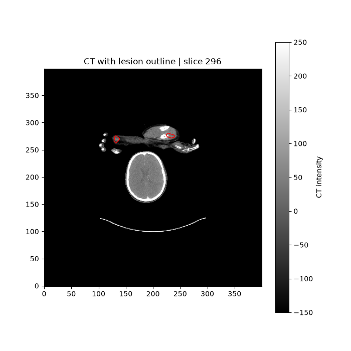
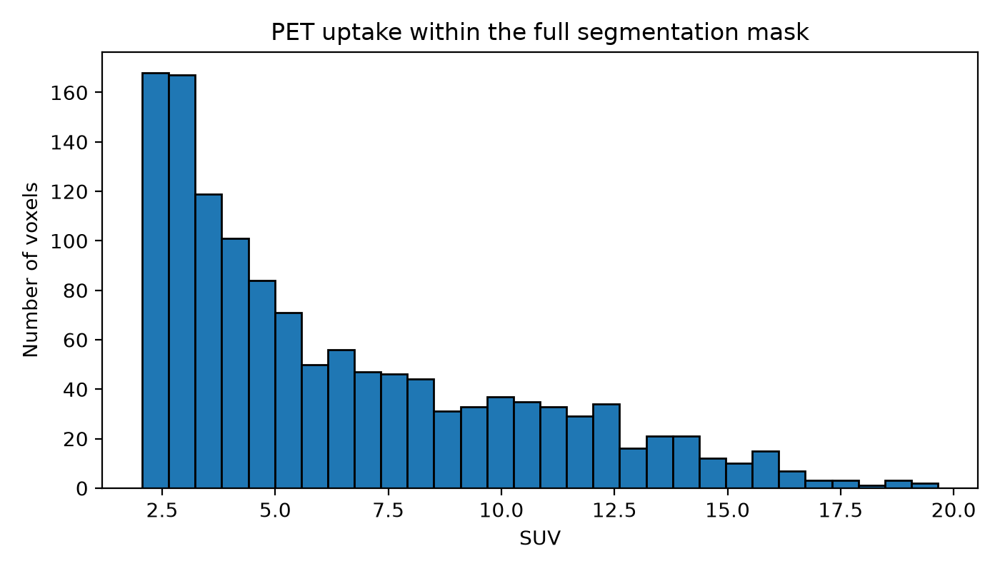

# PET/CT Radiomics

This is an ongoing project where I am learning to analyse PET/CT images and extract quantitative features using Python.

I started with one patient from the FDG-PET-CT-Lesions dataset to understand the image files, segmentation masks and spatial information before working with more patients.

## Aim

I want to investigate how radiomic features change when image preprocessing and segmentation settings are changed.

## Work completed

- Loaded PET, CT and segmentation files using NiBabel.
- Checked image dimensions and voxel spacing.
- Compared the spatial transforms of the three files.
- Checked the segmentation labels and counted the labelled voxels.
- Displayed the segmentation outline on PET and CT slices.

For the first case, all three images have dimensions of 400 × 400 × 326 and matching spatial transforms. The mask contains 1,299 labelled voxels.

The spatial units are not specified in the NIfTI headers. I still need to verify these before reporting physical measurements.

## Example

CT slice with the supplied segmentation outline:



This is an initial visual check of one slice. It does not establish alignment throughout the scan.

## Tools

- Python 3.11.9
- NumPy
- NiBabel
- Matplotlib

## Dataset

FDG-PET-CT-Lesions, provided by Sergios Gatidis and Thomas Küstner.

Dataset DOI: https://doi.org/10.7937/gkr0-xv29

Data paper: https://doi.org/10.1038/s41597-022-01718-3

The NIfTI dataset is provided under CC BY-NC 4.0. The example figure above was generated from this dataset with a segmentation outline added. The original image files are not included in this repository.

## Next steps

- Calculate basic PET uptake statistics within the mask.
- Extract radiomic features.
- Extend the analysis to more patients.
- Study feature sensitivity to resampling, discretization, and segmentation changes.

This project is still in progress. No clinical prediction or feature robustness results are available yet.

## First PET statistics

I calculated PET uptake statistics using all 1,299 voxels labelled 1 in the segmentation mask.

| Measurement | Value |
| --- | ---: |
| Mean SUV | 6.397499 |
| Median SUV | 5.095382 |
| Maximum SUV | 19.653612 |
| Standard deviation | 3.871733 |



The distribution has a long tail towards higher SUV values. The mean is higher than the median. These statistics describe the full mask for one patient, which may include several separate lesions.

## Running the script

I used Python 3.11 on Windows. To run the code, open PowerShell in the project folder and install the packages in a virtual environment:

```powershell
py -3.11 -m venv .venv
.\.venv\Scripts\python.exe -m pip install -r requirements.txt
```

The image files are not included in this repository. Put `SUV.nii.gz`, `CTres.nii.gz` and `SEG.nii.gz` from the same study in a folder called `pet-ct-radiomicsdataPETCT0011f3deaf`, beside the script. If you use a different folder name, update `data_dir` in the code.

Then run:

```powershell
.\.venv\Scripts\python.exe .\inspect_images.py
```

Close each plot window to continue. The script prints the image information and PET statistics, then saves the CSV, CT overlay and histogram.

