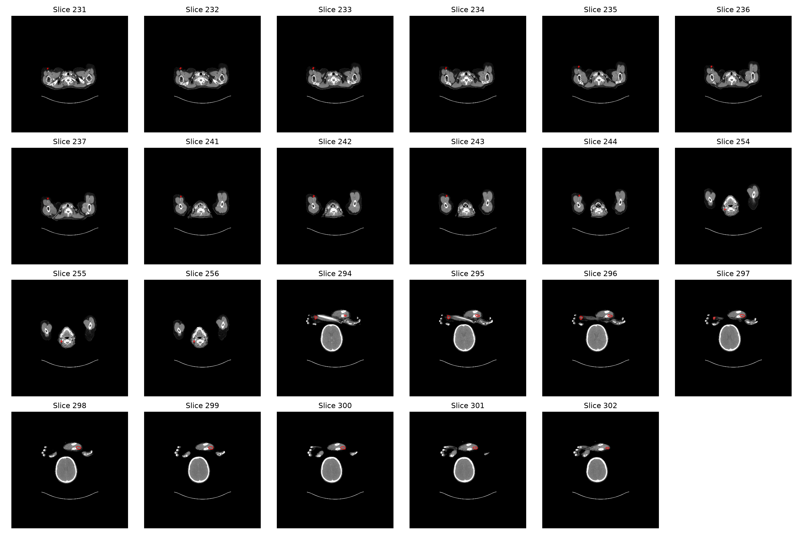
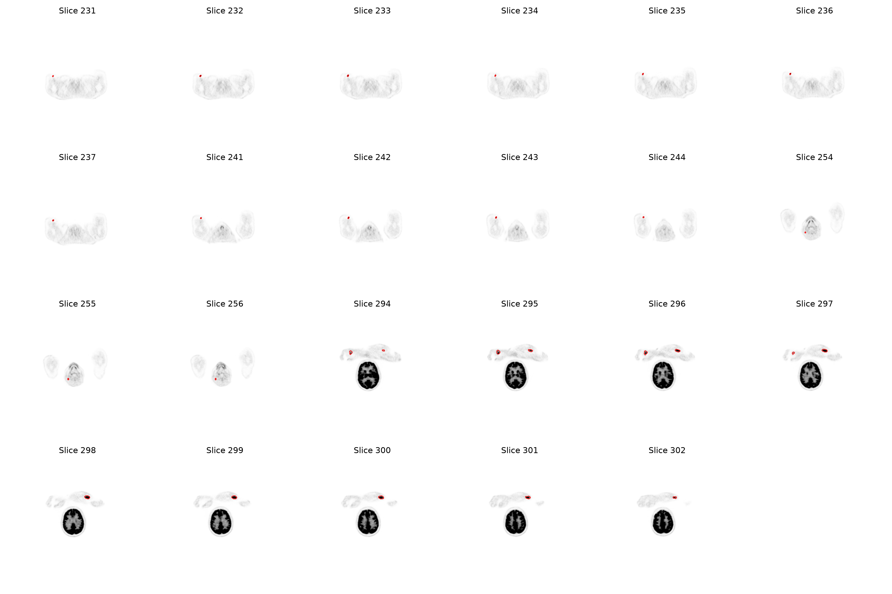
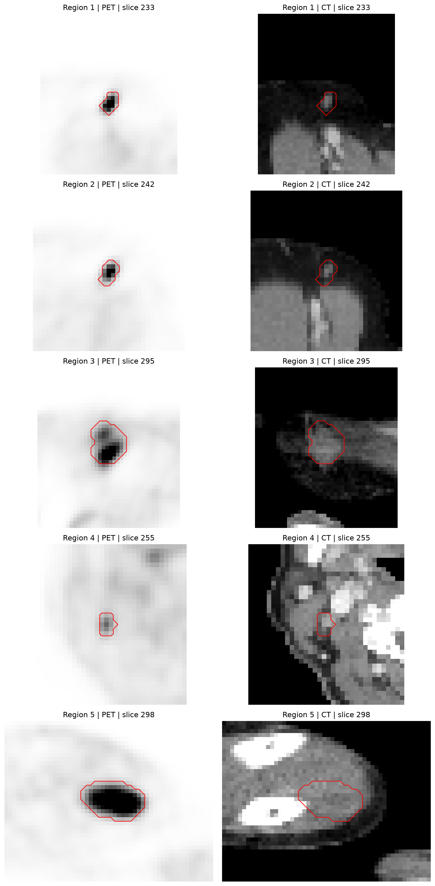
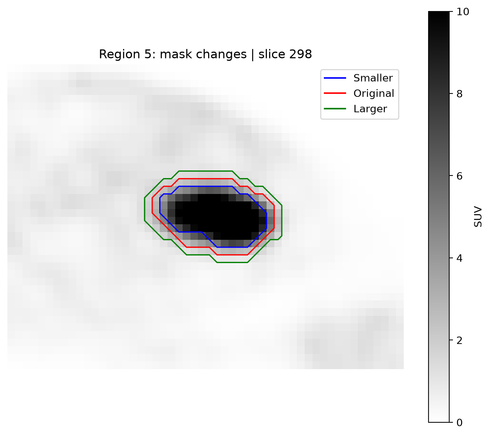

# PET/CT Radiomics

This is an ongoing project where I am learning to analyse PET/CT images and extract quantitative features using Python.

I started with one patient from the FDG-PET-CT-Lesions dataset to understand the image files, segmentation masks and spatial information before working with more patients.

## Aim

I want to investigate how radiomic features change when image preprocessing and segmentation settings are changed.

So far, I have calculated basic PET and CT statistics and carried out a first experiment with changes to the mask boundary.

## Tools

- Python 3.12.3 in Ubuntu through WSL
- NumPy for array operations and basic statistics
- NiBabel for reading NIfTI images
- Matplotlib for figures
- SciPy for connected regions, erosion and dilation
- VS Code for writing and running the code

The Ubuntu package versions are recorded in `requirements-wsl.txt`.

I initially used Python 3.11.9 on Windows. Windows blocked a Matplotlib file, and reinstalling the package did not solve the problem, so I continued using Ubuntu through WSL.

## Dataset

I am using the FDG-PET-CT-Lesions dataset, provided by Sergios Gatidis and Thomas Küstner.

- Dataset DOI: https://doi.org/10.7937/gkr0-xv29
- Data paper: https://doi.org/10.1038/s41597-022-01718-3

For the first case, I used three files from the same study:

- `SUV.nii.gz`: PET image containing SUV values
- `CTres.nii.gz`: CT image resampled to the PET grid
- `SEG.nii.gz`: segmentation mask

The NIfTI dataset is provided under CC BY-NC 4.0. The figures in this repository were generated from these images, with segmentation outlines added where shown. The original image files are not included in the repository.

## Work completed

- Loaded PET, CT and segmentation files using NiBabel.
- Checked image dimensions, voxel spacing and spatial transforms.
- Checked the mask labels and counted the labelled voxels.
- Calculated PET uptake statistics for the full mask.
- Made PET and CT overviews of all 23 slices containing the mask.
- Separated the mask into five connected regions using SciPy.
- Saved PET statistics and slice locations for each region.
- Made closer PET and CT views of each region.
- Tested how shrinking and expanding each region changed its mean SUV.
- Calculated CT intensity statistics for each region.

## Initial image checks

For the first case, all three images have dimensions of 400 × 400 × 326 and matching spatial transforms. The mask contains labels 0 and 1, with 1,299 voxels labelled 1.

The spatial units are not specified in the NIfTI headers. I still need to verify these before reporting physical measurements.

### Example CT slice

The figure below shows CT slice 296 with the supplied segmentation outlined in red.


This is an initial visual check of one slice. Matching spatial transforms and inspecting one slice do not establish alignment throughout the scan.

### Looking at more slices

The mask contains labelled voxels in 23 slices. I made PET and CT overview images to see where the mask appears across the scan.





These images give an overview, but the small panels are not enough to check alignment in detail. The PET images use a display range of 0–10 SUV.

The voxel counts for each mask-containing slice are saved in `mask_voxels_per_slice.csv`. Slice indices in the script and figures start at zero.

## First PET statistics

I calculated PET uptake statistics using all 1,299 voxels labelled 1 in the segmentation mask. All selected PET values were finite.

| Measurement | Value |
|---|---:|
| Mean SUV | 6.397499 |
| Median SUV | 5.095382 |
| Maximum SUV | 19.653612 |
| Standard deviation | 3.871733 |

The standard deviation was calculated using NumPy's default population standard deviation.


The distribution has a long tail towards higher SUV values, and the mean is higher than the median.

These statistics describe the full mask for one patient. The results are saved in `pet_mask_statistics.csv`.

## Connected regions in the mask

I used SciPy to separate the mask into connected regions. Voxels were considered connected if they shared a face, edge or corner, known as 26-connectivity.

This gave five regions:

| Region | Voxels |
|---|---:|
| 1 | 103 |
| 2 | 59 |
| 3 | 280 |
| 4 | 41 |
| 5 | 816 |
| Total | 1,299 |

I saved the PET uptake statistics for each region in `pet_region_statistics.csv`.

These are connected regions in the segmentation and should not automatically be treated as separate clinical lesions. Their numbers are labels assigned by the algorithm, rather than a ranking by size.

### A closer look at each region

I cropped the PET and CT images around each region to see the outlines more clearly. For each region, I chose the slice with the most mask voxels.

The PET image is on the left and the CT image is on the right. The red line shows the mask boundary. The region numbers match the rows in `pet_region_statistics.csv`.

Each crop covers a different area, so the regions are not all shown at the same scale.



The slice ranges and the slices shown in this figure are saved in `region_locations.csv`.

## Testing changes to the mask

I wanted to see how changing the mask boundary would affect the mean SUV. I started with Region 5, the largest connected region in this scan.

Using SciPy, I shrank the mask with one erosion step and expanded it with one dilation step. Both operations used face-sharing neighbours in 3D.

| Mask | Number of voxels | Mean SUV | Change from original |
|---|---:|---:|---:|
| Smaller | 432 | 10.246 | +40.28% |
| Original | 816 | 7.304 | 0% |
| Larger | 1,305 | 5.158 | −29.38% |

The mean SUV increased when I removed the outer voxels and decreased when I added surrounding voxels. This shows how the choice of boundary affected the measurement for this region.



Blue shows the smaller mask, red the original, and green the larger mask. The figure shows slice 298. The statistics were calculated using the full 3D masks.

The image display is limited to 0–10 SUV, but the calculations use the original PET values. The results are saved in `region5_mask_sensitivity.csv`.

The voxel counts changed substantially, so this needs to be considered when interpreting the SUV changes. These operations follow the voxel grid and do not change the boundary by a uniform distance in millimetres. The altered masks are experimental variations of the supplied mask.

### Repeating the test for all five regions

I repeated the same erosion and dilation steps for each connected region. Each region was changed independently.

| Region | Mean SUV change after shrinking | Mean SUV change after expanding |
|---|---:|---:|
| 1 | +108.22% | −44.97% |
| 2 | +77.09% | −40.87% |
| 3 | +57.54% | −33.95% |
| 4 | +53.89% | −29.60% |
| 5 | +40.28% | −29.38% |

The mean SUV increased after shrinking and decreased after expanding in all five regions.

However, shrinking left only 19 voxels in Region 1, eight in Region 2 and four in Region 4. These measurements therefore describe much smaller parts of the original regions.

The full results, including voxel counts, are saved in `all_regions_mask_sensitivity.csv`.

All five regions come from the same scan. This is an initial experiment and does not yet show how the results vary between patients.

## CT intensity within each region

I also calculated CT intensity statistics using the same five regions.

| Region | Voxels | Mean CT intensity |
|---|---:|---:|
| 1 | 103 | −76.87 |
| 2 | 59 | −56.69 |
| 3 | 280 | −2.70 |
| 4 | 41 | 39.25 |
| 5 | 816 | 70.33 |

The full results are saved in `ct_region_statistics.csv`, including the median, minimum, maximum and standard deviation.

These values come from `CTres.nii.gz`, the CT image resampled to the PET grid. I used the image values without applying the display limits from the figures.

## Running the script

I currently run the script using Python 3.12.3 in Ubuntu through WSL.

The image files are not included in this repository. Put `SUV.nii.gz`, `CTres.nii.gz` and `SEG.nii.gz` from the same study in a folder called `pet-ct-radiomicsdataPETCT0011f3deaf`, beside `inspect_images.py`.

If you use a different folder name, update `data_dir` in the script.

From the project folder in Ubuntu, create an environment and install the recorded packages:

```bash
python3 -m venv ~/pet-ct-radiomics-venv
~/pet-ct-radiomics-venv/bin/python -m pip install -r requirements-wsl.txt
```

Then run:

```bash
~/pet-ct-radiomics-venv/bin/python inspect_images.py
```

On my laptop, I can also run it from PowerShell in the project folder:

```powershell
wsl /home/footuser/pet-ct-radiomics-venv/bin/python ./inspect_images.py
```

The PowerShell command contains my Ubuntu username. Other users will need to use their own environment path.

The script prints image information and saves CSV files and PNG figures in the project folder. I open the figures in VS Code because plot windows are not available in my current setup.

`requirements.txt` records the earlier Windows environment. The current analysis uses `requirements-wsl.txt`.

## Output files

| File | Contents |
|---|---|
| `pet_mask_statistics.csv` | PET statistics for the full mask |
| `mask_voxels_per_slice.csv` | Mask voxel counts for each labelled slice |
| `pet_region_statistics.csv` | PET statistics for each connected region |
| `region_locations.csv` | First, last and selected slice indices for each region |
| `region5_mask_sensitivity.csv` | Mean SUV and voxel counts for the Region 5 mask experiment |
| `all_regions_mask_sensitivity.csv` | Mean SUV and voxel counts for the experiment across all five regions |
| `ct_region_statistics.csv` | CT intensity statistics for each region |
| `ct_mask_slice296.png` | CT slice 296 with the mask outline |
| `pet_suv_histogram.png` | PET uptake distribution within the full mask |
| `ct_mask_all_slices.png` | CT overview of all mask-containing slices |
| `pet_mask_all_slices.png` | PET overview of all mask-containing slices |
| `pet_ct_regions.png` | Cropped PET and CT views of each region |
| `region5_mask_changes.png` | Smaller, original and larger mask outlines on PET slice 298 |

## Limitations

- The analysis currently includes one scan from one patient.
- Connected regions from the same scan are not independent patient samples.
- The spatial units still need to be verified before calculating physical measurements.
- The figures support visual inspection but do not confirm alignment throughout the scan.
- The erosion and dilation experiments changed the voxel counts substantially, especially for the smaller regions.
- I have calculated basic intensity statistics so far. Texture features and a wider assessment of feature robustness are still to be done.
- I have not built a clinical prediction model.

## Next steps

- Verify the spatial units before calculating physical measurements.
- Organise the script so it is easier to use with more scans.
- Extract additional radiomic features with clearly recorded settings.
- Extend the analysis to more patients.
- Study how resampling, discretization and mask changes affect the features.
